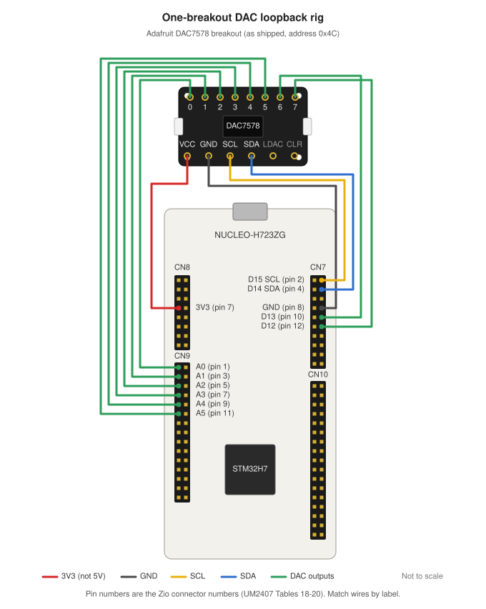

# Hardware Setup (NUCLEO-H723ZG)

## Prerequisites

### Install OpenOCD

```bash
sudo apt install openocd
```

### USB Permissions (udev Rules)

Create udev rules to allow non-root access to the ST-LINK debugger:

```bash
sudo tee /etc/udev/rules.d/99-stlink.rules << 'EOF'
# ST-LINK V2
ATTRS{idVendor}=="0483", ATTRS{idProduct}=="3748", MODE="0666", GROUP="plugdev"
# ST-LINK V2-1
ATTRS{idVendor}=="0483", ATTRS{idProduct}=="374b", MODE="0666", GROUP="plugdev"
# ST-LINK V3
ATTRS{idVendor}=="0483", ATTRS{idProduct}=="374e", MODE="0666", GROUP="plugdev"
ATTRS{idVendor}=="0483", ATTRS{idProduct}=="374f", MODE="0666", GROUP="plugdev"
EOF

sudo udevadm control --reload-rules
sudo udevadm trigger
```

### WSL Users

If using WSL, you need to pass the USB device through using `usbipd`:

```powershell
# In Windows PowerShell (Admin)
usbipd list
usbipd bind --busid <BUSID>
usbipd attach --wsl --busid <BUSID>
```

After setting up udev rules, you may need to re-attach the device for the rules to take effect.

Verify the device is visible:
```bash
lsusb | grep STMicroelectronics
# Should show: STMicroelectronics STLINK-V3
```

## Building for Hardware

```bash
source ~/zephyrproject/.venv/bin/activate
export ZEPHYR_BASE=~/zephyrproject/zephyr

cd ~/code/zephyr-nucleo-h723zg-example
west build -b nucleo_h723zg app --pristine
```

**Note:** If you encounter Kconfig errors about `HAS_CMSIS_CORE`, ensure you have the CMSIS modules installed:
```bash
cd ~/zephyrproject && west update cmsis cmsis_6
```

## Flashing

Flash using OpenOCD (recommended):

```bash
west flash --runner openocd
```

**Troubleshooting:**

| Error | Solution |
|-------|----------|
| `LIBUSB_ERROR_ACCESS` | Set up udev rules (see above) and re-attach USB device |
| `no runners.yaml found` | Rebuild with `--pristine` for the hardware target |
| `STM32_Programmer_CLI not found` | Use `--runner openocd` instead |

## Test Rig: DAC Loopback

The board tests itself. A DAC7578 on the Nucleo's own I²C bus drives voltages
that are wired straight back into its ADC inputs. The firmware drives it with
the same `ti,dacx578` driver it runs against the virtual PCB, so the physical
suite exercises the same code path — only the copper is real.

The rig comes in two sizes, chosen at build time:

| | One breakout (default) | Two breakouts |
|---|---|---|
| Channels driven | 0–7 | 0–14 |
| Soldering | **None** | One bridge, on U1's address jumper |
| Addresses | `0x4c` | `0x48` and `0x4c` |
| Firmware build | `west build -b nucleo_h723zg app` | add `-- -DDTS_EXTRA_CPPFLAGS=-DAPP_DAC_COUNT=2` |
| Test config | `configs/physical.yaml` as shipped | set `num_channels: 15` |
| Virtual twin | `configs/vpcb-one-dac.yaml` | `configs/vpcb.yaml` |
| Netlist it mirrors | `vpcb/netlists/adc_loopback_one_dac.txt` | `vpcb/netlists/adc_loopback.txt` |

With one breakout the firmware still samples all 15 ADC channels. Channels 8–14
have nothing wired to them, so their pins float and read whatever they pick up.
On the virtual PCB those same channels show `---`, because the board model knows
they are undriven and a real ADC cannot — see
[walkthrough 2](../walkthroughs/02-fault-injection.md).

The devicetree nodes are in `app/boards/nucleo_h723zg.overlay`.

### Hookup Diagram (One Breakout)



Twelve wires. The drawing is not to scale: match each wire by the pin labels on
the boards. Leave `VRf`, the `GND` at the end of the output row, `LDAC` and
`CLR` unconnected — `VRf` is already tied to VCC on the breakout. Connector and pin numbers are the Zio connector numbers from ST's
user manual for this board, UM2407 Rev 4, Tables 18–20, and are listed in
[DAC-to-ADC Wiring](#dac-to-adc-wiring) below.

### Equipment

- **DUT:** NUCLEO-H723ZG
- **DAC:** 1 × Adafruit DAC7578 breakout (8-channel, 12-bit, I²C), or 2 for all 15 channels
- **Wires:** 12 jumpers for one breakout — power, ground, clock, data, and 8 outputs
- **USB:** one cable to the Nucleo. No bench supply, no mux controller, no network instrument.

### I²C Bus

I²C1 is the Arduino I²C (`arduino_i2c`) on this board. The board devicetree
already enables it; the overlay runs it at 100 kHz for this rig (see pull-ups,
below).

| Signal | Nucleo pin | Arduino | Connector |
|--------|------------|---------|-----------|
| SCL | PB8 | D15 | CN7-2 |
| SDA | PB9 | D14 | CN7-4 |
| GND | — | GND | CN7-8 |
| VDD | — | 3V3 | Arduino power header (CN8) |

**Pull-ups:** leave them fitted — add none, remove none. The Adafruit board
has 10 kΩ on SDA and SCL. At 400 kHz the limit is a 300 ns rise time, which
10 kΩ only meets below roughly 35 pF of bus capacitance — easy to exceed with
jumper wires. So the overlay runs this bus at **100 kHz**, where the limit is
1000 ns and one 10 kΩ set is comfortable. Two breakouts put 5 kΩ on the bus,
which is fine at either speed. An earlier version of this page said to remove
one set; don't.

### Addresses

The address is strapped, not programmed. The pins are named **ADDR1/ADDR0** in
the datasheet, and each is tied low, tied high, or left floating.

With **one breakout** there is nothing to strap: it ships answering at `0x4c`,
and the default firmware build expects exactly that.

With **two**, they must differ:

| Part | Address | ADDR1 | ADDR0 | Serves board channels |
|------|---------|-------|-------|-----------------------|
| U1 | `0x48` | GND | GND | 0–7 |
| U2 | `0x4c` | **float** | **GND** | 8–14 (channel 7 unused) |

These match the two addresses the virtual PCB models, so one firmware image
drives either.

**Floating both pins does not give `0x4c`** — the datasheet lists ADDR1 float +
ADDR0 float as *Not supported*, and a part strapped that way will not answer at
any address. Only ADDR1 is floated; ADDR0 goes to ground.

Full table for the QFN-24 (RGE) package, from SBAS496B Table 3:

| Address | ADDR1 | ADDR0 |
|---------|-------|-------|
| `0x48` | 0 | 0 |
| `0x49` | 0 | 1 |
| `0x4a` | 1 | 0 |
| `0x4b` | 1 | 1 |
| `0x4c` | float | 0 |
| `0x4d` | float | 1 |
| `0x4e` | 0 | float |
| `0x4f` | 1 | float |
| — | float | float | *(not supported)* |

The **TSSOP-16 (PW)** package brings out only ADDR0 and offers three addresses:
`0x48` (GND), `0x4a` (high), `0x4c` (float). If your breakout is the TSSOP part,
float its single address pin for U2.

Many breakouts fit pull-up or pull-down resistors on the address pins, which
makes "floating" impossible until you remove them. Check your board before
soldering: if you cannot float a pin, the alternative is to strap U2 to `0x4a`
(ADDR1 high, ADDR0 low) and change `reg` in
[`app/boards/nucleo_h723zg.overlay`](../app/boards/nucleo_h723zg.overlay), the
`dacs:` list in `tests/integration/configs/vpcb.yaml`, and the netlist.

### Reference Voltage

Full-scale output **equals VREFIN**. The datasheet's Equation 1 is

    VOUT = (code / 2^n) × VREFIN

with a unity-gain output buffer. `full-scale-mv` in the overlay is `3300`, so
**VREFIN must be 3.3 V** — the same rail that powers the part.

> **Correction.** This page used to say the output buffer has a gain of two and
> that VREFIN must be 1.65 V. That was wrong: there is no gain stage. A rig
> built to those instructions reads every channel at half its set voltage.

On the Adafruit DAC7578 breakout this needs no work at all: its `Vrf` jumper
ties the reference to VCC by default, so powering the board from the Nucleo's
3V3 pin gives a 3.3 V reference. **Leave the `Vrf` jumper intact.** If you do
use a different reference, change `full-scale-mv` in
`app/boards/nucleo_h723zg.overlay` to match it.

### Adafruit Breakout: What to Change

**One breakout: change nothing.** Leave the address jumper open and the `Vrf`
jumper intact, exactly as it ships.

Two breakouts:

| Board | Address jumper | `Vrf` jumper | Result |
|-------|----------------|--------------|--------|
| U1 | Bridge centre pad to **GND** | Leave intact | `0x48`, 3.3 V full scale |
| U2 | **Leave open** (the default) | Leave intact | `0x4c`, 3.3 V full scale |

Either way, power from 3V3, not 5 V: a 5 V supply would raise the reference to
5 V and drive the ADC inputs past their limit.

### DAC-to-ADC Wiring

Each DAC output goes to the same Nucleo pin the retired rig's mux output of the
same number used, so an existing harness can be rewired output-for-output. The
breakout labels its outputs 0–7.

**One breakout wires rows 0–7 only** — its outputs 0–7 to board channels 0–7.
Rows 8–14 are for a second breakout.

| Board ch | DAC output | Nucleo pin | ADC input | Connector |
|----------|------------|------------|-----------|-----------|
| 0 | U1 ch0 | PA3 | ADC1_INP15 | CN9-1 (A0) |
| 1 | U1 ch1 | PC0 | ADC1_INP10 | CN9-3 (A1) |
| 2 | U1 ch2 | PC3 | **ADC3_INP1** | CN9-5 (A2) |
| 3 | U1 ch3 | PB1 | ADC1_INP5 | CN9-7 (A3) |
| 4 | U1 ch4 | PC2 | **ADC3_INP0** | CN9-9 (A4) |
| 5 | U1 ch5 | PF10 | ADC3_INP6 | CN9-11 (A5) |
| 6 | U1 ch6 | PA5 | ADC1_INP19 | CN7-10 (D13) |
| 7 | U1 ch7 | PA6 | ADC1_INP3 | CN7-12 (D12) |
| 8 | U2 ch0 | PA4 | ADC1_INP18 | CN7-17 (D24) |
| 9 | U2 ch1 | PF3 | ADC3_INP5 | CN7-20 (D8) |
| 10 | U2 ch2 | PF4 | ADC3_INP9 | CN10-7 (A6) |
| 11 | U2 ch3 | PF5 | ADC3_INP4 | CN10-9 (A7) |
| 12 | U2 ch4 | PF6 | ADC3_INP8 | CN10-11 (A8) |
| 13 | U2 ch5 | PA0 | ADC1_INP16 | CN10-29 (D32) |
| 14 | U2 ch6 | PB0 | ADC1_INP9 | CN10-31 (D33) |
| — | U2 ch7 | — | — | unused |

**Important:** PC2 and PC3 are `PC2_C` and `PC3_C` pins that only connect to ADC3, not ADC1!

**A4 and A5 on a modified board.** Two solder-bridge pairs decide what CN9 pins 9
and 11 connect to. From the factory (UM2407 Table 14, default states in bold),
SB53 and SB60 are on and SB55 and SB62 are off, so A4 and A5 are plain analog
inputs (PC2, PF10). A board reworked for Arduino Uno shields has SB55/SB62 on,
which joins A4 and A5 to PB9 and PB8 — the I²C bus this rig uses — and DAC
outputs 4 and 5 would then drive the bus. On a second-hand board, check for
continuity between CN9-9 and CN7-4, and between CN9-11 and CN7-2, before
powering up.

### Driving It By Hand

`dacset` is built for hardware as well as for the virtual PCB:

```
uart:~$ dacset 0 2000
dacset ch0 -> dacx578@4c ch0 code=2481 OK
uart:~$ adcregs
    ch[0]: 1998 mV
```

That is the one-breakout build; with two, channel 0 is served by `dacx578@48`.
Asking a one-breakout build for channel 8 or above is refused with
`channel must be 0..7 - this board is built with 1 DAC`.

A `-5` failure means nothing answered on the bus: the part is absent,
unpowered or mis-strapped, or SDA or SCL is off. The STM32 driver reports every
I²C failure as `-5`, so the code alone can't say which; check the wiring first.

The firmware also reads back a register from each DAC every sample cycle. While
one doesn't answer, `adcregs` shows `---` on its channels, with one line each
way: `W: dacx578@4c not answering (-5) - its channels read ---`, then
`I: dacx578@4c answering again`.
(The virtual board once said `-19` here. See
[the root-cause write-up](rca/i2c-nack-error-code.md).)

### What the Loopback Can't Tell You

The board drives its own test signal and then measures it. A fault that corrupts
the DAC write and the ADC read identically would pass. Keep a scope on a couple
of outputs as an independent witness, and use the virtual PCB — where the IC
model is a separate process — for fault injection.

A probe is part of the circuit, though. On the firmware before the
sampling-time fix (below), A4's worst error over the sweep was −78 mV with a 1X
scope probe clipped to it and −133 mV without: the ADC was borrowing charge from
the probe's capacitance. Measure with a probe, but know it can change the
reading it is there to check.

### What the Virtual Board Can't Tell You

The virtual PCB models what a circuit does, not how long it takes. The first
bench run found a bug the virtual board passed at every step: the ADC was set to
the shortest sampling window it has, too short for its sampling capacitor to
charge through the pin. A4 read 214 mV low at 3.2 V, the other inputs on ADC3
sagged the same way, and the ADC1 inputs read high. The fix is one line in
`app/targets/hw/adc_backend.c`, a file the virtual board never builds.
[Walkthrough 4](../walkthroughs/04-real-hardware.md) finds and fixes it.

It goes the other way too. On the virtual board a cut wire reads `---`, because
the board knows the net is undriven. On the bench, a cut wire leaves the pin
floating and the ADC reads whatever charge is on it — with A5 unplugged, 95 mV
when the DAC was at 0 and 281 mV when it was at 2.8 V. The loopback still
catches it, because a cut input doesn't follow its DAC: every round of
`test_channel_isolation` failed on channel 5, and only on channel 5.

## ADC Channel Mapping

15 channels are configured by default in `app/boards/nucleo_h723zg.conf`, with
the ADC pin assignments in `app/boards/nucleo_h723zg.overlay`.

### ADC Peripheral Mapping

| ADC | Channels Used | Pins |
|-----|---------------|------|
| ADC1 | INP3, INP5, INP9, INP10, INP15, INP16, INP18, INP19 | PA0, PA3, PA4, PA5, PA6, PB0, PB1, PC0 |
| ADC3 | INP0, INP1, INP4, INP5, INP6, INP8, INP9 | PC2, PC3, PF3, PF4, PF5, PF6, PF10 |

**Note:** PC2 and PC3 are special `PC2_C`/`PC3_C` pins that only connect to ADC3 (not ADC1).

## NUCLEO-H723ZG Connector Pinout Reference

From ST's UM2407 (Rev 4), Tables 18–21. CN7, CN8, CN9 and CN10 are the **Zio**
connectors (Arduino Uno V3 plus extensions); the ST morpho connectors are CN11
and CN12. Odd pins are one row of each header and even pins the other.

### CN9 - Zio, Arduino Analog Header
| Pin | MCU Pin | Function |
|-----|---------|----------|
| 1 | PA3 | A0 / ADC1_INP15 |
| 3 | PC0 | A1 / ADC1_INP10 |
| 5 | PC3 | A2 / ADC1_INP13 |
| 7 | PB1 | A3 / ADC1_INP5 |
| 9 | PC2 | A4 / ADC1_INP12 |
| 11 | PF10 | A5 / ADC3_INP6 |

### CN7 - Zio (ADC pins only)
| Pin | MCU Pin | Function |
|-----|---------|----------|
| 10 | PA5 | D13 / ADC1_INP19 |
| 12 | PA6 | D12 / ADC1_INP3 |
| 17 | PA4 | D24 / ADC1_INP18 |
| 20 | PF3 | D8 / ADC3_INP5 |

### CN10 - Zio (ADC pins only)
| Pin | MCU Pin | Function |
|-----|---------|----------|
| 7 | PF4 | A6 / ADC3_INP9 |
| 9 | PF5 | A7 / ADC3_INP4 |
| 11 | PF6 | A8 / ADC3_INP8 |
| 29 | PA0 | D32 / ADC1_INP16 |
| 31 | PB0 | D33 / ADC1_INP9 |

CN10 pin 27 is GND. An earlier version of this page put D32 there, one row off.

## Connecting via Serial

The NUCLEO board exposes a USB serial port. Connect and use:

```bash
# Find the port
ls /dev/ttyACM*

# Connect with screen, minicom, or similar
screen /dev/ttyACM0 115200
```

## Identifying Device Ports by VID/PID

When multiple USB devices are connected, you can identify which serial port corresponds to which device using USB Vendor ID (VID) and Product ID (PID).

### List Connected USB Devices

```bash
# Show all USB devices with VID:PID
lsusb
```

Expected output for the loopback rig — the Nucleo is the only USB device:
```
Bus 001 Device 002: ID 0483:374e STMicroelectronics STLINK-V3
```

### Map Serial Ports to USB Devices

**Linux:**

```bash
# For each serial port, check its VID/PID
udevadm info -q path -n /dev/ttyACM0 | xargs udevadm info -p | grep -E "ID_VENDOR=|ID_MODEL=|ID_USB_VENDOR_ID=|ID_USB_MODEL_ID="
udevadm info -q path -n /dev/ttyACM1 | xargs udevadm info -p | grep -E "ID_VENDOR=|ID_MODEL=|ID_USB_VENDOR_ID=|ID_USB_MODEL_ID="
```

**macOS:**

```bash
# List serial ports with device info
ioreg -p IOUSB -l -w 0 | grep -E "@|idVendor|idProduct|IODialinDevice"
```

### Device VID/PID Reference

| Device | VID | PID | Port (Linux) | Port (macOS) |
|--------|-----|-----|--------------|--------------|
| ST-LINK V2 | 0483 | 3748 | `/dev/ttyACM*` | `/dev/cu.usbmodem*` |
| ST-LINK V2-1 | 0483 | 374b | `/dev/ttyACM*` | `/dev/cu.usbmodem*` |
| ST-LINK V3 | 0483 | 374e | `/dev/ttyACM*` | `/dev/cu.usbmodem*` |
| ST-LINK V3 (alt) | 0483 | 374f | `/dev/ttyACM*` | `/dev/cu.usbmodem*` |
| Adafruit KB2040 (retired rig) | 239a | 8105 | `/dev/ttyACM*` | `/dev/cu.usbmodem*` |

### Updating Test Configuration

Once you've identified the Nucleo's port, update `tests/integration/configs/physical.yaml`:

```yaml
dut:
  type: physical
  port: /dev/ttyACM0  # Nucleo ST-LINK (VID:0483 PID:374e)
  baudrate: 115200

instrument:
  type: dac

num_channels: 15
```

## Differences from Simulator

- `adcset` does **not exist** on hardware builds — there is no injection backdoor
- `dacset` **does** exist on hardware builds, and drives the real DACs
- ADC values come from real analog inputs
- Sampling happens at the same configurable rate

## Running Integration Tests

### Prerequisites

```bash
pip install -r tests/integration/requirements.txt
```

No instrument libraries are needed: every rig drives its stimulus through the
DUT's own shell.

### Physical Hardware Tests

Flash the board, wire the loopback rig, then:

```bash
PYTHONPATH=tests/integration pytest tests/integration/ \
  --config=tests/integration/configs/physical.yaml -v
```

About two minutes, most of it `test_voltage_sweep`: every channel from 50 mV to
3.25 V in 25 mV steps. It writes its readings to
`tests/integration/results/voltage_sweep-physical.csv` and plots their errors
in `voltage_sweep-physical.svg`. Add `-s` to print the worst error per channel.

The DAC holds its outputs through a firmware flash and between runs, so a
channel you set by hand is still driven when the tests start. Power-cycle the
rig, or `dacset` every channel to 0, for a clean start.

### Virtual PCB Tests

Same instrument, no hardware:

```bash
cmake -S vpcb -B build-vpcb && cmake --build build-vpcb
west build -b native_sim app -d build-vpcb-fw --pristine
PYTHONPATH=tests/integration pytest tests/integration/ \
  --config=tests/integration/configs/vpcb.yaml -v
```

That is the two-DAC board. To run the twin of the one-breakout bench rig — same
chip count, same address, same eight channels — before powering the real one:

```bash
west build -b native_sim app -d build-vpcb-fw-one-dac --pristine -- \
  -DDTS_EXTRA_CPPFLAGS=-DAPP_DAC_COUNT=1
PYTHONPATH=tests/integration pytest tests/integration/ \
  --config=tests/integration/configs/vpcb-one-dac.yaml -v
```

### QEMU Tests

```bash
west build -b qemu_x86 app -d build-qemu --pristine
PYTHONPATH=tests/integration pytest tests/integration/ \
  --config=tests/integration/configs/virtual.yaml -v
```

## Retired Rig: Bench Supply + Mux

**Retired 2026-09. Not used by any config.** Kept for reference, because it is
why `PHYSICAL_TOLERANCE` in `tests/integration/test_adc.py` was 150 mV, and why
`test_channel_isolation` only drove one channel at a time. Both changed once the
DAC rig ran on the bench: see
[walkthrough 4](../walkthroughs/04-real-hardware.md).

The original rig fanned a single bench-supply output through a 16:1 analog
multiplexer. That meant **only one channel could ever be driven at a time**, and
the mux's on-resistance added roughly 100 mV of error.

### 15-Channel Mux Wiring

#### Equipment
- **Power Supply:** Rigol DP832 (Channel 3, 0-5V output)
- **Mux:** CD74HC4067 16-channel analog multiplexer on KB2040
- **DUT:** NUCLEO-H723ZG

#### Wiring Diagram

```
Rigol DP832 CH3 ──────► CD74HC4067 Common (SIG)
                              │
                    ┌─────────┴─────────┐
                    │   16:1 MUX        │
                    │   Outputs C0-C14  │
                    └─────────┬─────────┘
                              │
              ┌───────────────┼───────────────┐
              │               │               │
              ▼               ▼               ▼
           CN9 (A0-A5)    CN7 (D8,D12,    CN10 (A6-A8,
                              D13,D24)        D32,D33)
```

#### Complete Wiring Table

| Mux Output | Nucleo Pin | ADC Input | Connector Pin | Wire Color (suggested) |
|------------|------------|-----------|---------------|------------------------|
| C0 | PA3 | ADC1_INP15 | CN9-1 (A0) | Brown |
| C1 | PC0 | ADC1_INP10 | CN9-3 (A1) | Red |
| C2 | PC3 | **ADC3_INP1** | CN9-5 (A2) | Orange |
| C3 | PB1 | ADC1_INP5 | CN9-7 (A3) | Yellow |
| C4 | PC2 | **ADC3_INP0** | CN9-9 (A4) | Green |
| C5 | PF10 | ADC3_INP6 | CN9-11 (A5) | Blue |
| C6 | PA5 | ADC1_INP19 | CN7-10 (D13) | Purple |
| C7 | PA6 | ADC1_INP3 | CN7-12 (D12) | Gray |
| C8 | PA4 | ADC1_INP18 | CN7-17 (D24) | White |
| C9 | PF3 | ADC3_INP5 | CN7-20 (D8) | Black |
| C10 | PF4 | ADC3_INP9 | CN10-7 (A6) | Brown/White |
| C11 | PF5 | ADC3_INP4 | CN10-9 (A7) | Red/White |
| C12 | PF6 | ADC3_INP8 | CN10-11 (A8) | Orange/White |
| C13 | PA0 | ADC1_INP16 | CN10-29 (D32) | Yellow/White |
| C14 | PB0 | ADC1_INP9 | CN10-31 (D33) | Green/White |

**Note:** Mux outputs C0-C15 match software channels 0-15. We use C0-C14 (15 channels).

**Important:** PC2 and PC3 are `PC2_C` and `PC3_C` pins that only connect to ADC3, not ADC1!

#### Ground Connections

Connect GND between all devices:
- Rigol DP832 GND
- KB2040 Mux GND
- NUCLEO-H723ZG GND (CN7-8, CN10-17, or any GND pin)

#### ADC Channel Summary by Connector

| Connector | Pins Used | ADC Channels |
|-----------|-----------|--------------|
| CN9 | 6 pins | A0-A5 (INP15, INP10, INP13, INP5, INP12, ADC3_INP6) |
| CN7 | 4 pins | D8, D12, D13, D24 (ADC3_INP5, INP3, INP19, INP18) |
| CN10 | 5 pins | A6-A8, D32, D33 (ADC3_INP9/4/8, INP16, INP9) |

### Finding the Rigol DP832 IP Address

To find the IP address of the Rigol DP832 power supply:

**On the Rigol DP832 front panel:**
1. Press **Utility** button
2. Navigate to **I/O Config → LAN Settings**
3. The IP address will be displayed

**Alternative methods:**
- Check your router's DHCP client list for a device named "RIGOL" or "DP832"
- Scan your network: `nmap -sn 192.168.68.0/24 | grep -B 2 "Rigol\|DP832"`

### Known Limitations of the Mux Rig

#### CD74HC4067 Mux On-Resistance

The CD74HC4067 analog multiplexer has significant on-resistance (Ron) that causes voltage drop between the power supply and ADC input:

| Supply Voltage | Typical Ron | Expected Error |
|----------------|-------------|----------------|
| 5.0V | 50-70Ω | ~50-70mV |
| **3.3V** | **~100Ω** | **~80-120mV** |
| 2.0V | ~200Ω | ~150-200mV |

**This is a known limitation of the CD74HC4067 family.** At 3.3V supply, expect ~100mV measurement error due to the mux on-resistance.

##### Mitigation Options

1. **Accept the tolerance** - Tests used a 150mV tolerance to account for this
2. **Software calibration** - Apply per-channel offset correction in firmware
3. **Buffer amplifier** - Add unity-gain op-amp between mux output and ADC input
4. **Lower-Ron mux** - Use ADG1606/ADG1607 (~4Ω Ron) for higher accuracy

##### Ground Connections Are Critical

Ensure a proper star ground connection between:
- Rigol DP832 GND (Channel 3 negative)
- KB2040 Mux board GND
- Nucleo GND (preferably CN9 pin 14, near analog inputs)

Poor grounding can add additional 30-50mV of error.
