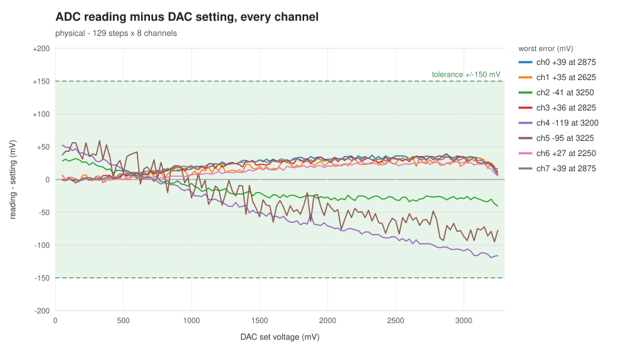
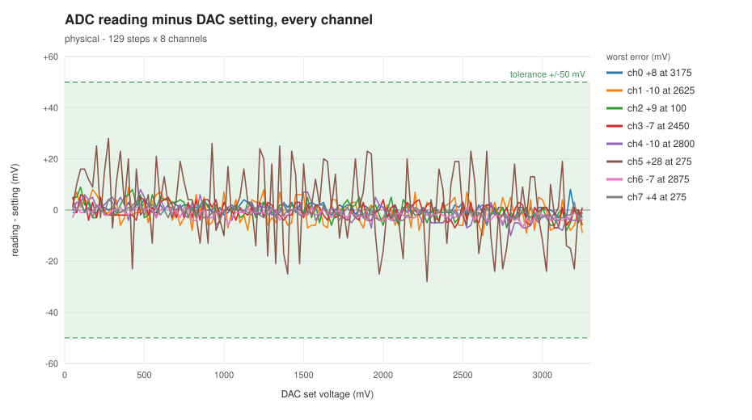
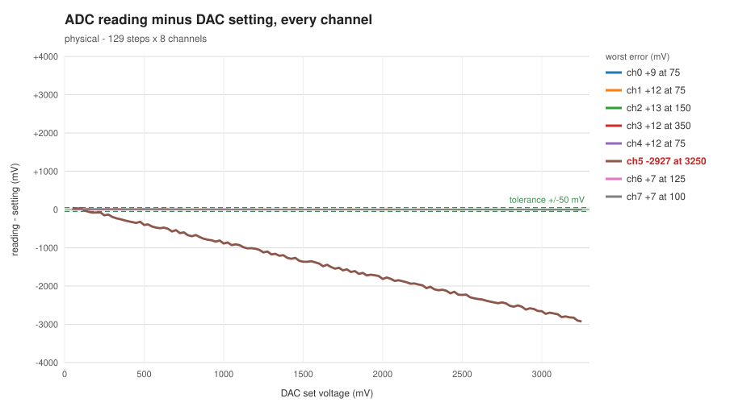

# Walkthrough 4 — Put it on real hardware

The virtual board passes every test. Now wire up the real one and find out what
the virtual board couldn't tell you.

Go back to the moment before the first bench run and run the tests as they
were. They pass. Then replace them, one commit at a time, with tests the old
bench rig could never have run. They pass too — but one of them draws a plot,
and the plot shows a bug that every pass/fail check waved through. The fix is
one line. Then cut a real wire, and answer the question
[Walkthrough 2](02-fault-injection.md) left open. Last, pull a bus wire, and
watch the real board correct the virtual one.

Every file path, line number and code snippet below is taken from the actual
commits, and every block of output was captured on a real NUCLEO-H723ZG.

**Time:** about 30 minutes, plus wiring.
**You need:** a NUCLEO-H723ZG, one Adafruit DAC7578 breakout, twelve jumper
wires, a USB cable, OpenOCD (`sudo apt install openocd`, then unplug and replug
the board), and [Walkthrough 1](01-virtual-pcb.md)'s toolchain.

---

## Step 1 — Wire it

Twelve wires, no soldering. The diagram and the full table are in
[docs/hardware.md](../docs/hardware.md#hookup-diagram-one-breakout).


Power the DAC from the Nucleo's **3V3** pin — not 5 V, and not a separate
supply. The DAC's full scale is its supply voltage, and the ADC measures against
the Nucleo's 3.3 V. On the same rail, any drift in that rail cancels out.

The DAC writes a voltage, a wire carries it to an ADC pin, and the ADC reads it
back. That's the same loop the virtual board runs, with copper instead of a
socket.

---

## Step 2 — Go back to before the bench run

The repository has a tag marking the moment just before the first bench run.
Make your own branch from it:

```bash
source ~/zephyrproject/.venv/bin/activate && export ZEPHYR_BASE=~/zephyrproject/zephyr && cd ~/code/zephyr-nucleo-h723zg-example
```

```bash
git checkout -b bench-it-myself before-bench-run
```

Build and flash:

```bash
west build -b nucleo_h723zg app -d build-hw --pristine && west flash -d build-hw --runner openocd
```

Open the serial console (`screen /dev/ttyACM0 115200`), drive all eight
channels to 3.2 V and read them back:

```
dacset 0 3200
dacset 1 3200
dacset 2 3200
dacset 3 3200
dacset 4 3200
dacset 5 3200
dacset 6 3200
dacset 7 3200
adcregs
```

```
    ch[0]: 3221 mV
    ch[1]: 3222 mV
    ch[2]: 3168 mV
    ch[3]: 3221 mV
    ch[4]: 3082 mV
    ch[5]: 3109 mV
    ch[6]: 3216 mV
    ch[7]: 3223 mV
```

Real copper, real silicon, and every channel within about a tenth of a volt —
inside the 150 mV the tests allow. Nothing looks wrong.

Channels 8 to 14 read numbers too, with nothing wired to them. A floating pin
converts to whatever it picks up. The virtual board shows `---` there, because
it knows the wire isn't connected; a real ADC can't know that.

Set every channel back to 0 V before going on (`dacset <ch> 0`). The DAC holds
its outputs through a reflash, and the tests below assume they start from zero.

---

## Step 3 — Run the tests as they were

```bash
PYTHONPATH=tests/integration pytest tests/integration/ --config=tests/integration/configs/physical.yaml -v
```

```
======================= 24 passed, 28 skipped in 17.99s ========================
```

All 24 pass. (The 28 skipped are the fault matrix from
[Walkthrough 2](02-fault-injection.md), which needs the virtual board.)

Now look at what they ask.

**`tests/integration/test_adc.py`** — lines 18–20

```python
# Tolerance for physical hardware tests (in mV)
# ~100mV accounts for mux on-resistance (~70Ω) and ADC quantization
PHYSICAL_TOLERANCE = 150
```

150 mV — a tenth of a volt and then some — for a switch that is no longer in the
circuit. The old rig fed one bench supply through a 16-way analog switch, and
the switch's resistance cost about 100 mV.

**`tests/integration/test_adc.py`** — lines 208–211

```python
        # Drive only the specified channel
        instrument.enable_output(driven_channel, True)
        instrument.set_voltage(driven_channel, test_voltage)
        wait_for_fresh_sample(dut)
```

The isolation test drives **one** channel and checks the others don't read the
same thing. With one supply behind a switch, that was the only question the rig
could physically ask. The voltage sweep has the same limit: six voltages, on
channel 0 only.

The DAC can drive all eight channels at once. Time to ask better questions.

---

## Step 4 — Ask the real isolation question

```bash
git cherry-pick 8404a4c
```

**`tests/integration/test_adc.py`** — lines 236–248

```python
        expected = isolation_levels(num_test_channels, rotation)

        for ch, mv in expected.items():
            instrument.enable_output(ch, True)
            instrument.set_voltage(ch, mv)
        wait_for_fresh_sample(dut)

        response = dut.send_command("adcregs")
        wrong = []
        for ch, mv in expected.items():
            actual = parse_channel_value(response, ch)
            if abs(actual - mv) > PHYSICAL_TOLERANCE:
                wrong.append(f"ch[{ch}]={actual}mV, expected ~{mv}mV")
```

Every channel at a **different** voltage, all at the same time, each one
checked against its own. That's the chord the old rig could never play.

The voltages are spread from 300 mV to 3 V, and neighbouring channels sit
several steps apart, so two channels shorted together can't both read right:

**`tests/integration/test_adc.py`** — lines 135–140

```python
    step = (ISOLATION_HIGH_MV - ISOLATION_LOW_MV) / max(n - 1, 1)
    levels = [ISOLATION_LOW_MV + round(i * step) for i in range(n)]

    # The largest stride under n/2 that still visits every level once
    stride = next(s for s in range(max(n // 2, 1), 0, -1) if math.gcd(s, n) == 1)
    return {ch: levels[(ch * stride + rotation) % n] for ch in range(n)}
```

Each of the eight test cases shifts the pattern by one step, so by the end
every channel has held every voltage.

```bash
PYTHONPATH=tests/integration pytest tests/integration/test_adc.py --config=tests/integration/configs/physical.yaml -v -k isolation
```

```
tests/integration/test_adc.py::TestADCIsolation::test_channel_isolation[0] PASSED
tests/integration/test_adc.py::TestADCIsolation::test_channel_isolation[1] PASSED
tests/integration/test_adc.py::TestADCIsolation::test_channel_isolation[2] PASSED
tests/integration/test_adc.py::TestADCIsolation::test_channel_isolation[3] PASSED
tests/integration/test_adc.py::TestADCIsolation::test_channel_isolation[4] PASSED
tests/integration/test_adc.py::TestADCIsolation::test_channel_isolation[5] PASSED
tests/integration/test_adc.py::TestADCIsolation::test_channel_isolation[6] PASSED
tests/integration/test_adc.py::TestADCIsolation::test_channel_isolation[7] PASSED
```

Eight channels, eight voltages, all at once, all correct. Is it a test that can
fail? On the virtual board, swap two wires in the netlist and every rotation
fails. It can.

---

## Step 5 — Sweep every channel

The old sweep tried six voltages on one channel. Try all of them, on every
channel:

```bash
git cherry-pick 068d642
```

**`tests/integration/test_adc.py`** — lines 221–229

```python
        channels = range(num_test_channels)
        rows = []
        for set_mv in SWEEP_MV:
            for ch in channels:
                instrument.enable_output(ch, True)
                instrument.set_voltage(ch, set_mv)
            wait_for_fresh_sample(dut)
            response = dut.send_command("adcregs")
            rows.append((set_mv, {ch: parse_channel_value(response, ch) for ch in channels}))
```

All eight channels together, from 50 mV to 3.25 V in 25 mV steps: 129 steps,
over a thousand readings. The test writes them to `tests/integration/results/`
as a CSV file, and plots how far each reading is from what the DAC was told to
drive.

```bash
PYTHONPATH=tests/integration pytest tests/integration/test_adc.py --config=tests/integration/configs/physical.yaml -v -s -k sweep
```

```
Worst error per channel over 129 steps (tolerance 150 mV):
  ch[ 0]   +39 mV at 2875 mV
  ch[ 1]   +35 mV at 2625 mV
  ch[ 2]   -41 mV at 3250 mV
  ch[ 3]   +36 mV at 2825 mV
  ch[ 4]  -119 mV at 3200 mV
  ch[ 5]   -95 mV at 3225 mV
  ch[ 6]   +27 mV at 2250 mV
  ch[ 7]   +39 mV at 2875 mV
PASSED
```

It passes. Now open the plot,
`tests/integration/results/voltage_sweep-physical.svg`:



**That isn't noise. It's two different shapes.**

- Channels 2, 4 and 5 — the A2, A4 and A5 pins — sag further and further below
  the line as the voltage rises. A4 is 119 mV low at 3.2 V.
- The other five sit about 35 mV *above* the line.

The STM32H723 has more than one ADC inside it, and this firmware uses two.
A2, A4 and A5 are read by ADC3; the other five by ADC1. Two ADCs, two different
errors, and the tolerance is wide enough to wave both through.

Run it a few times and the numbers move — A4 has read anywhere from 119 to
214 mV low on this bench. A bug that drifts between runs is easy to miss with a
pass/fail check, and hard to miss on a plot.

### What the virtual board says

Run the same sweep against the virtual twin of this rig (one DAC, eight
channels — build it as in [Walkthrough 1](01-virtual-pcb.md) with
`-DDTS_EXTRA_CPPFLAGS=-DAPP_DAC_COUNT=1`):

```bash
PYTHONPATH=tests/integration pytest tests/integration/test_adc.py --config=tests/integration/configs/vpcb-one-dac.yaml -v -s -k sweep
```

```
Worst error per channel over 129 steps (tolerance 150 mV):
  ch[ 0]    -2 mV at 50 mV
  ch[ 1]    -2 mV at 50 mV
  ch[ 2]    -2 mV at 50 mV
  ch[ 3]    -2 mV at 50 mV
  ch[ 4]    -2 mV at 50 mV
  ch[ 5]    -2 mV at 50 mV
  ch[ 6]    -2 mV at 50 mV
  ch[ 7]    -2 mV at 50 mV
```

Flat. The virtual board isn't wrong — it models what the circuit *does*: which
pin connects to which, and what voltage each chip drives. It doesn't model how
*long* anything takes. And this bug is about time.

---

## Step 6 — Find the cause

An ADC doesn't measure a pin directly. Before each conversion it connects a tiny
capacitor to the pin, waits for it to charge to the pin's voltage, then
disconnects it and measures the capacitor. If the wait is too short, the
capacitor never gets all the way there: it's still partly at wherever it was
before. The two ADCs evidently start from different places, which is why one
group reads high and the other sags.

How long is the wait?

**`app/targets/hw/adc_backend.c`** — lines 122–128

```c
        channel_cfgs[i] = (struct adc_channel_cfg){
            .gain = ADC_GAIN_1,
            .reference = ADC_REF_INTERNAL,  /* STM32 uses VREF+ pin (3.3V) */
            .acquisition_time = ADC_ACQ_TIME_DEFAULT,  /* Use driver default */
            .channel_id = channel_mappings[i].channel_id,
            .differential = 0,  /* Single-ended mode */
        };
```

*"Use driver default."* For the STM32 driver, the default is the **shortest**
sampling window the ADC has. It reads like the safe choice. It isn't.

### A scope probe makes it better

Clip a scope probe to A4 and the error shrinks. In one pair of runs on this
bench, A4's worst error was −78 mV with a 1X probe attached and −133 mV
without. The probe and its cable add capacitance to the pin, and the ADC
borrows charge from it to fill its own capacitor faster.

The instrument you'd reach for to check the reading changes the reading. Worth
knowing before you trust a measurement made with a probe on the pin.

---

## Step 7 — The fix

```bash
git cherry-pick 227509d
```

**`app/targets/hw/adc_backend.c`** — lines 125–131

```c
            /*
             * Sample for as long as the ADC allows. The driver default is the
             * shortest window, too short for the sampling capacitor to charge
             * through the pin: A4 read 214 mV low at 3.2 V. We convert every
             * 100 ms, so there is no reason to hurry.
             */
            .acquisition_time = ADC_ACQ_TIME_MAX,
```

One line. The firmware converts each channel once every 100 ms, so the longest
window costs nothing.

This file is only built for the real board. The virtual board never compiles
it, so its results couldn't change — and didn't need to.

```bash
west build -d build-hw && west flash -d build-hw --runner openocd
```

```bash
PYTHONPATH=tests/integration pytest tests/integration/ --config=tests/integration/configs/physical.yaml -v -s
```

```
Worst error per channel over 129 steps (tolerance 150 mV):
  ch[ 0]    +7 mV at 2600 mV
  ch[ 1]   -12 mV at 2950 mV
  ch[ 2]    -9 mV at 2875 mV
  ch[ 3]    -7 mV at 3100 mV
  ch[ 4]   -10 mV at 3100 mV
  ch[ 5]   +29 mV at 200 mV
  ch[ 6]    -6 mV at 2950 mV
  ch[ 7]    -7 mV at 3000 mV
...
================== 19 passed, 28 skipped in 107.54s (0:01:47) ==================
```

A4 went from −119 mV to −10. Both groups land on the line.



Note the scale: this plot spans ±60 mV, the one before spanned ±200. Every
channel now averages within 2 mV of the DAC. Channel 5 — A5 — is the one that
still wiggles: about ±30 mV of noise around the right answer. Its average is
correct, so this isn't the sampling bug; it's that one pin picking up noise.

---

## Step 8 — Tighten the tolerance

150 mV was for a switch that's gone, and it was wide enough to let a 119 mV bug
pass. The bench has now shown what this rig can really do.

```bash
git cherry-pick 43d6afa
```

**`tests/integration/test_adc.py`** — lines 20–29

```python
# How far a reading may sit from the voltage the DAC was set to, in mV.
#
# A DAC7578 at its datasheet limits is off by up to ~13 mV (offset, gain,
# quantisation - see DATASHEET_TOL_MV in test_faults.py). On the bench, every
# channel reads within 12 mV across the whole range, except A5, which carries
# about 30 mV of noise around a correct mean. 50 covers both, and still fails
# the ADC sampling-time bug, which read 214 mV low.
#
# It was 150, for a bench supply behind an analog mux that is no longer here.
PHYSICAL_TOLERANCE = 50
```

Every part of the number is accounted for: the DAC's datasheet budget, what the
bench measured, and the bug it has to keep catching.

```bash
PYTHONPATH=tests/integration pytest tests/integration/ --config=tests/integration/configs/physical.yaml -v
```

```
================== 19 passed, 28 skipped in 107.52s (0:01:47) ==================
```

Does it really catch the bug? Flash the firmware from Step 2 again and run these
same tests against it:

```
E       AssertionError: ch[4]=1926mV, expected ~2000mV (tolerance=50)
E       AssertionError: rotation 0: ch[4]=1782mV, expected ~1843mV; ch[5]=2914mV, expected ~3000mV (tolerance=50)
E       AssertionError: out of tolerance (50 mV): ch[4] -120 mV at 3200 mV; ch[5] -91 mV at 3025 mV. Plot: .../voltage_sweep-physical.svg
...
============= 9 failed, 10 passed, 28 skipped in 107.34s (0:01:47) =============
```

Nine failures — the single-channel check on A4, the sweep, and seven of the
eight isolation rotations. The tests from Step 3 passed this exact firmware.

Same test names as Step 3. Completely different questions.

---

## Step 9 — Cut a wire

On the virtual board, a cut wire reads `---`, because the board knows nothing
is driving the pin. [Walkthrough 2](02-fault-injection.md#step-10--what-the-twin-cant-promise)
admitted real copper can't know that, and guessed the bench would need "a test
that checks a channel moves when you expect it to." Here's that test.

Cut a wire for real: pull the jumper from **A5** at the Nucleo end (CN9 pin 11)
and leave the DAC end plugged in. Then drive channels 4, 5 and 6 together:

```
dacset 4 0
dacset 5 0
dacset 6 0
adcregs
```

```
    ch[4]: 3 mV
    ch[5]: 95 mV
    ch[6]: 4 mV
```

**The needle can't tell.** Channel 5 shows a number, not `---`. A real ADC
converts a floating pin to whatever charge happens to be sitting on it, and
nothing in the reading says it's meaningless. That part of the virtual board's
fix doesn't carry over to copper.

**But you can add fuel and watch the needle.** Drive all three to 500 mV, then
to 2800 mV:

```
    ch[4]: 509 mV
    ch[5]: 101 mV
    ch[6]: 501 mV
```

```
    ch[4]: 2802 mV
    ch[5]: 281 mV
    ch[6]: 2797 mV
```

Channels 4 and 6 follow. Channel 5 creeps up a little when its neighbours are
high, but nowhere near 2.8 V. A connected input follows the DAC; a cut one
doesn't. That's exactly what the isolation test and the sweep check, on every
channel:

```bash
PYTHONPATH=tests/integration pytest tests/integration/test_adc.py --config=tests/integration/configs/physical.yaml -v -s -k "isolation or sweep"
```

```
E       AssertionError: rotation 0: ch[5]=170mV, expected ~3000mV (tolerance=50)
E       AssertionError: rotation 1: ch[5]=224mV, expected ~300mV (tolerance=50)
E       AssertionError: rotation 2: ch[5]=270mV, expected ~686mV (tolerance=50)
E       AssertionError: rotation 3: ch[5]=294mV, expected ~1071mV (tolerance=50)
E       AssertionError: rotation 4: ch[5]=141mV, expected ~1457mV (tolerance=50)
E       AssertionError: rotation 5: ch[5]=161mV, expected ~1843mV (tolerance=50)
E       AssertionError: rotation 6: ch[5]=133mV, expected ~2229mV (tolerance=50)
E       AssertionError: rotation 7: ch[5]=169mV, expected ~2614mV (tolerance=50)
...
================= 9 failed, 10 deselected in 101.97s (0:01:41) =================
```

Every round fails, and every failure names channel 5 and only channel 5. The
sweep shows it at a glance — one line falls away while the other seven sit on
zero:



Look at rotation 1. Channel 5 should hold 300 mV, and the floating pin happened
to read 224. The old 150 mV tolerance would have passed that round. One reading
can match by luck; eight different voltages can't.

That's the answer. On real hardware you can't tell a cut wire
from a single reading. You can tell by changing what you send and checking the
reading follows — and the tests now do that on every channel, every run.

Plug A5 back in.

---

## Step 10 — Pull SDA

Walkthrough 1's other fault was a chip that stops answering. On the bench,
pull the DAC's **SDA** wire at the Nucleo end (D14, CN7 pin 4) with channel 0
holding 2000 mV, then try to change it:

```
dacset 0 500
```

```
dacset ch0: write to dacx578@4c FAILED (-5)
```

```
adcregs
```

```
    ch[0]: 1997 mV
    ch[1]: 0 mV
```

Two things to notice.

**The reading doesn't change, and that's correct.** The DAC is still powered
and still driving the last value it was given, so channel 0 really is at
2000 mV. Only the write path is broken. That's why there is no `---`: on a real
board, `---` means the ADC itself couldn't read, and it could.

**The error code is wrong — on the virtual board.** For a chip that doesn't
answer, the virtual board always said `-19`. The real board says `-5`. The
real STM32 I²C driver reports every bus failure as `-5`: no acknowledge, lost
bus, timeout, all the same. The virtual board's `-19` was chosen before there
was any hardware to check it against, and it was never checked.
[The root-cause write-up](../docs/rca/i2c-nack-error-code.md) has the history.

The fix went into the virtual board, not the firmware. It now returns `-5` like
the real driver, and keeps its more detailed log line:

```
E: addr 0x48 NAK - no device on the virtual bus
dacset ch0: write to dacx578@48 FAILED (-5) - nothing answered on the bus
```

That's the loop this whole series runs on. Build and test on the virtual board.
Run the same tests on the real one. Where they disagree, the hardware is right
and the virtual board gets fixed. `-19` would still be wrong without a bench.

Plug SDA back in.

---

## Cleanup

```bash
git checkout main && git branch -D bench-it-myself
```

```bash
west build -b nucleo_h723zg app -d build-hw --pristine && west flash -d build-hw --runner openocd
```

---

## What to take away

**Look at the shape, not just the verdict.** Every test passed on the buggy
firmware. The sweep's plot showed two ADCs disagreeing by over 150 mV the first
time anyone looked at it.

**A loose tolerance hides bugs.** 150 mV covered a switch that was gone, and a
bug that was there. Tightened to what the bench can really do, the same tests
fail the old firmware nine times.

**You can't read a cut wire. You can test for one.** A floating pin reads a
number, not `---`. Drive it to a few very different voltages and it gives itself
away by not following.

**The bench corrects the virtual board, too.** The virtual board said `-19` for
a chip that doesn't answer; the real driver says `-5`. Hardware wins, and the
virtual board gets fixed.

**The virtual board was right about everything it models.** Wiring, chips,
addresses, drivers, error paths — all of it carried over. What it doesn't model
is physics: time, charge, noise. Test virtually first, then on the bench, and
expect the bench to teach you something.
