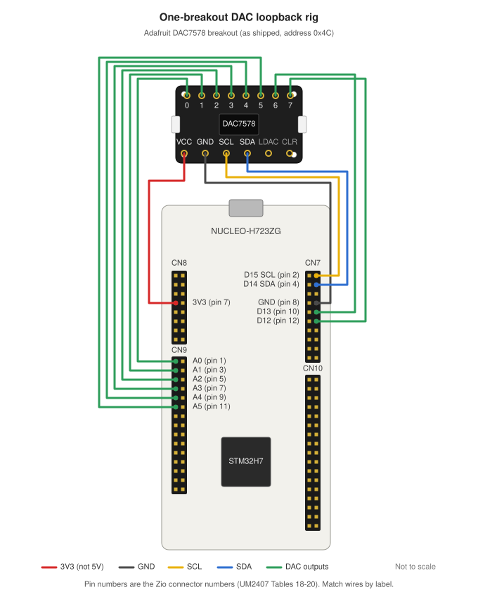
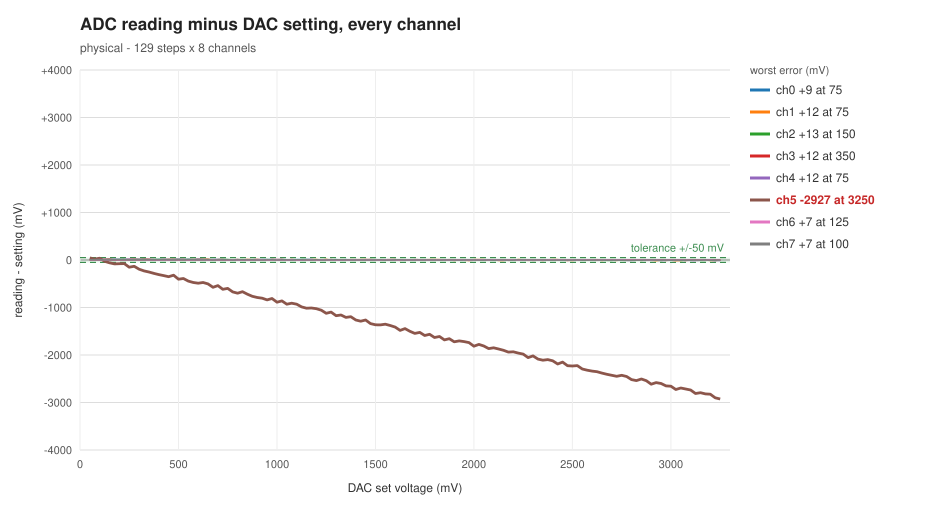

# Walkthrough 4 — Put it on real hardware

[Walkthrough 2](02-fault-injection.md) broke the virtual board two ways: it cut
a wire, and it pulled a chip. The firmware reported both. Now do both to a real
board, and find out which answers carry over.

The bench rig is one DAC chip wired back into the board's own ADC, so the board
drives every channel itself: no multiplexer, no bench supply. The DAC writes a
voltage, a wire carries it to an ADC pin, and the ADC reads it back.

Every file path, line number and code snippet below is taken from the actual
commits, and every block of output was captured from a real run — on a real
NUCLEO-H723ZG, unless it says it's the virtual board.

**Time:** about 15 minutes, plus wiring.
**You need:** a NUCLEO-H723ZG, one Adafruit DAC7578 breakout, twelve jumper
wires, a USB cable, OpenOCD (`sudo apt install openocd`, then unplug and replug
the board), and [Walkthrough 1](01-virtual-pcb.md)'s toolchain.

---

## Step 1 — Wire it

Twelve wires, no soldering. The diagram and the full table are in
[docs/hardware.md](../docs/hardware.md#hookup-diagram-one-breakout).



Power the DAC from the Nucleo's **3V3** pin — not 5 V, and not a separate
supply. The DAC's full scale is its supply voltage, and the ADC measures against
the Nucleo's 3.3 V. On the same rail, any drift in that rail cancels out.

That's the same loop the virtual board runs, with copper instead of a socket.

---

## Step 2 — Start from before the bench run

The tag `before-sda-pull` is the firmware as it was just before this bench run.
The virtual board still says `-19` for a chip that doesn't answer, and nothing
checks that the DAC is still there. Set up the shell and make your own branch
from it:

```bash
source ~/zephyrproject/.venv/bin/activate && export ZEPHYR_BASE=~/zephyrproject/zephyr && cd ~/code/zephyr-nucleo-h723zg-example
```

```bash
git checkout -b bench-it-myself before-sda-pull
```

Build and flash:

```bash
west build -b nucleo_h723zg app -d build-hw --pristine && west flash -d build-hw --runner openocd
```

Open the serial console:

```bash
screen /dev/ttyACM0 115200
```

The DAC holds its outputs through a reflash, so start every channel at 0 V:

```
dacset 0 0
dacset 1 0
dacset 2 0
dacset 3 0
dacset 4 0
dacset 5 0
dacset 6 0
dacset 7 0
adcregs
```

```
    ch[0]: 12 mV
    ch[1]: 22 mV
    ch[2]: 15 mV
    ch[3]: 20 mV
    ch[4]: 23 mV
    ch[5]: 14 mV
    ch[6]: 14 mV
    ch[7]: 15 mV
```

All eight wired channels sit near zero. Channels 8 to 14 read numbers too, with
nothing wired to them; Step 3 is about why.

---

## Step 3 — Cut a wire

On the virtual board, a cut wire reads `---`, because the board knows nothing
is driving the pin. [Walkthrough 2](02-fault-injection.md#step-10--what-the-twin-cant-promise)
ended on the question: can real hardware tell?

Cut a wire for real: pull the jumper from **A5** at the Nucleo end (CN9 pin 11)
and leave the DAC end plugged in. Then drive channels 4, 5 and 6 together:

```
dacset 4 0
dacset 5 0
dacset 6 0
adcregs
```

```
    ch[4]: 3 mV
    ch[5]: 95 mV
    ch[6]: 4 mV
```

**It can't.** Channel 5 shows a number, not `---`. A real ADC converts a
floating pin to whatever charge happens to be sitting on it, and nothing in the
reading says the pin isn't connected. The firmware has no way to know. Only
extra hardware could change that, such as a resistor that pulls a floating pin
to a known voltage, and this rig has none. This is the one place the virtual
board and copper must disagree.

**But a test can catch it.** Like a fuel gauge, add fuel and watch the needle.
Drive all three to 500 mV:

```
dacset 4 500
dacset 5 500
dacset 6 500
adcregs
```

```
    ch[4]: 509 mV
    ch[5]: 101 mV
    ch[6]: 501 mV
```

Then to 2800 mV:

```
dacset 4 2800
dacset 5 2800
dacset 6 2800
adcregs
```

```
    ch[4]: 2802 mV
    ch[5]: 281 mV
    ch[6]: 2797 mV
```

Channels 4 and 6 follow. Channel 5 creeps up a little when its neighbours are
high, but nowhere near 2.8 V. A connected input follows the DAC; a cut one
doesn't.

Two tests in the repository check exactly that, on every channel:

- The **isolation test** sets every channel to a different voltage at once and
  checks each one reads its own. Over eight rounds, every channel holds every
  voltage.
- The **sweep** drives all eight together from 50 mV to 3.25 V and plots how
  far each reading is from the DAC.

```bash
PYTHONPATH=tests/integration pytest tests/integration/test_adc.py --config=tests/integration/configs/physical.yaml -v -s -k "isolation or sweep"
```

```
E       AssertionError: rotation 0: ch[5]=170mV, expected ~3000mV (tolerance=50)
E       AssertionError: rotation 1: ch[5]=224mV, expected ~300mV (tolerance=50)
E       AssertionError: rotation 2: ch[5]=270mV, expected ~686mV (tolerance=50)
E       AssertionError: rotation 3: ch[5]=294mV, expected ~1071mV (tolerance=50)
E       AssertionError: rotation 4: ch[5]=141mV, expected ~1457mV (tolerance=50)
E       AssertionError: rotation 5: ch[5]=161mV, expected ~1843mV (tolerance=50)
E       AssertionError: rotation 6: ch[5]=133mV, expected ~2229mV (tolerance=50)
E       AssertionError: rotation 7: ch[5]=169mV, expected ~2614mV (tolerance=50)
...
================= 9 failed, 10 deselected in 101.97s (0:01:41) =================
```

Every round fails, and every failure names channel 5 and only channel 5. The
sweep shows it at a glance — one line falls away while the other seven sit on
zero:



Look at rotation 1. Channel 5 should hold 300 mV, and the floating pin happened
to read 224. A looser tolerance, say 150 mV, would have passed that round. One
reading can match by luck; eight different voltages can't.

That's the answer. On real hardware the firmware can't detect a cut wire from a
reading. A test can, by changing what it sends and checking the reading
follows, and these tests do that on every channel, every run.

Plug A5 back in.

---

## Step 4 — Pull SDA

The other fault was a chip that stops answering. Set channel 0 to 2000 mV:

```
dacset 0 2000
```

Pull the DAC's **SDA** wire at the Nucleo end (D14, CN7 pin 4), then try to
change it:

```
dacset 0 500
```

```
dacset ch0: write to dacx578@4c FAILED (-5)
```

```
adcregs
```

```
    ch[0]: 1997 mV
    ch[1]: 0 mV
```

Now compare the virtual board, where Walkthrough 1 killed the chip process:

```
dacset ch0: write to dacx578@48 FAILED (-19) - device did not ACK
```

— and its channels read `---`. Same fault, two disagreements.

**The error code.** `-19` on the virtual board, `-5` on the real one. The
STM32 I²C driver reports every bus failure as `-5`: no acknowledge, lost bus,
timeout, all the same. The virtual board's `-19` was chosen before there was
any hardware to check it against, and it was never checked.
[The root-cause write-up](../docs/rca/i2c-nack-error-code.md) has the history.
That one is the virtual board's mistake.

**The readings.** The virtual board showed `---` only because it knew the
chip's pins had stopped being driven. On the bench the DAC is still powered and
still driving its last value, so the ADC reads a true 2000 mV — and the
firmware, which can no longer reach the chip, shows that number as if nothing
were wrong. That one is the firmware's mistake: it never asked whether the
chip was still there.

Fix both:

```bash
git cherry-pick f6557a7 404c49d 31cbc80 90f9985 37d7b89
```

Step 5 reads what they change. First, see them work. Plug SDA back in, then
rebuild and flash:

```bash
west build -d build-hw && west flash -d build-hw --runner openocd
```

Set every channel to 1000 mV:

```
dacset 0 1000
dacset 1 1000
dacset 2 1000
dacset 3 1000
dacset 4 1000
dacset 5 1000
dacset 6 1000
dacset 7 1000
```

Pull SDA again. Within one sample cycle:

```
W: dacx578@4c not answering (-5) - its channels read ---
```

```
    ch[0]: ---
    ch[1]: ---
    ...
    ch[7]: ---
```

```
dacset ch0: write to dacx578@4c FAILED (-5) - nothing answered on the bus
```

The pins still hold 1000 mV. But the firmware has lost the part that set them,
so it no longer vouches for the number. Plug SDA back in:

```
I: dacx578@4c answering again
```

```
    ch[0]: 1008 mV
    ch[1]: 1000 mV
```

---

## Step 5 — Read the fix

Five commits went in at Step 4:

```bash
git log --reverse --format=%s -5
```

```
fix(vpcb): report an unanswered I2C write as -5, like the real driver
fix(vpcb): a DAC7578 command byte on its own selects a read-back
feat: a DAC that stops answering marks its channels ---, on both boards
fix(vpcb): log an I2C fault when it starts, not on every transfer
vpcb: log register read-backs only with -v
```

They hold two separate fixes, one for each disagreement. The first commit
fixes the error code. The third gives you the dashes. The rest support those
two.

### The error code: the virtual board now says `-5`

**`app/drivers/i2c_vpcb.c`** — lines 171–186

```c
	/*
	 * Every bus failure returns -EIO, because that is what the real driver
	 * returns. Zephyr's I2C API promises only -EIO for a failed transfer,
	 * and the STM32 driver (drivers/i2c/i2c_stm32_v2.c) folds a NACK, lost
	 * arbitration and a timeout into it. This driver used to return -ENODEV
	 * for a NACK, on the untested assumption that a real bus would; the
	 * first bench run read -5 (docs/rca/i2c-nack-error-code.md).
	 *
	 * The log line still says which failure it was. The virtual board may
	 * say more than the real one, but it must not return something else.
	 */
	if (kind == XFER_OK) {
		LOG_DBG("xfer addr=0x%02x wlen=%u rlen=%u OK", addr, wlen, rlen);
		return 0;
	}
	return -EIO;
```

This file is the virtual board's I²C driver. It isn't built for the real
board at all, so this fix changes nothing on the bench. The real driver said
`-5` all along. `-EIO` is `-5`: a general I/O error, the code the real driver
gives for a missing acknowledge and for every other bus failure.

`dacset` prints its hint from the same code, so both boards now say the same
thing:

**`app/src/cmd_dac.c`** — lines 118–121

```c
		shell_error(sh,
			    "dacset ch%u: write to %s FAILED (%d)%s",
			    ch, dev->name, ret,
			    ret == -EIO ? " - nothing answered on the bus" : "");
```

### The dashes: the firmware asks whether the DAC is still there

Every sample cycle, after the ADC is read and before the readings are stored,
the firmware checks the DACs:

**`app/src/main.c`** — lines 46–50

```c
    while (1) {
        ret = adc_backend_sample_all(samples, valid);
        if (ret == 0) {
            dac_health_apply(valid);
            regs_update(samples, valid);
```

The check reads back one register from the chip:

**`app/drivers/dac_dacx578.c`** — lines 92–104

```c
int dacx578_check(const struct device *dev)
{
	const struct dacx578_config *config = dev->config;
	/* Read back channel 0's DAC register: the command byte, then a repeated
	 * start and two data bytes (datasheet, Table 6 and the read sequences).
	 * Nothing is written - a command only takes effect after a full data
	 * byte pair - so this changes no output.
	 */
	uint8_t ca = DACX578_CMD_UPDATE_DAC << 4;
	uint8_t data[2];

	return i2c_write_read_dt(&config->bus, &ca, 1, data, sizeof(data));
}
```

A read-back changes no output. The second commit teaches the virtual board's
DAC model the same rule, so the check is harmless on both boards.

Then each DAC that doesn't answer has its channels marked "no reading":

**`app/src/dac_health.c`** — lines 41–62

```c
	for (size_t i = 0; i < ARRAY_SIZE(parts); i++) {
		struct dac_part *p = &parts[i];
		int ret = dacx578_check(p->dev);
		bool now = (ret == 0);

		/* Once per change of state, not ten times a second. */
		if (now != p->answering) {
			if (now) {
				LOG_INF("%s answering again", p->dev->name);
			} else {
				LOG_WRN("%s not answering (%d) - its channels read ---",
					p->dev->name, ret);
			}
			p->answering = now;
		}

		if (!now) {
			for (unsigned int ch = p->first_ch;
			     ch < p->first_ch + DAC_CH_PER_PART && ch < NUM_CH; ch++) {
				valid[ch] = false;
			}
		}
```

Look at `bool now = (ret == 0);`. Any failure counts: `-5`, `-19`, anything.
The error code has nothing to do with the dashes. The real board said `-5`
before this fix and after it. What changed is that the firmware now asks.

The loop marks only the channels a DAC drives, from `first_ch` for eight
channels: 0 to 7 on this rig. Channels 8 to 14 have no DAC, so this fix doesn't
touch them. They're unwired, floating pins like A5 in Step 3, and they keep
reading numbers whether SDA is in or out.

From there it's [Walkthrough 3](03-fix-it-layer-by-layer.md)'s path: a channel
with no reading prints `---` in `adcregs`. The last two commits keep the logs
quiet, now that something talks to every DAC ten times a second.

The virtual board now does exactly the same, for the same reason: the same
firmware check gets the same I²C answer. The one thing that still differs is a
floating pin (Step 3), and that you test for.

That's the loop this whole series runs on. Build and test on the virtual board.
Run the same tests on the real one. Where they disagree, find out which one is
wrong — here, one of each — and fix it. Neither `-19` nor the confident 2000 mV
would have been caught without the bench.

---

## Cleanup

```bash
git checkout main && git branch -D bench-it-myself
```

```bash
west build -b nucleo_h723zg app -d build-hw --pristine && west flash -d build-hw --runner openocd
```

---

## What to take away

**You can't read a cut wire. You can test for one.** A floating pin reads a
number, not `---`, and the firmware can't know it isn't connected. Drive it to a
few very different voltages and it gives itself away by not following.

**The bench corrects both boards.** The virtual board said `-19` for a chip
that doesn't answer; the real driver says `-5`. And the firmware kept showing
confident numbers from a chip it could no longer reach. One was the virtual
board's mistake, one was the firmware's, and only the bench showed either.

**Test virtually first, then on the bench.** The wiring, the chip, its address
and its driver all carried over from the virtual board unchanged. Where the two
boards disagreed, the bench showed which one was wrong. Expect it to teach you
something every time.
